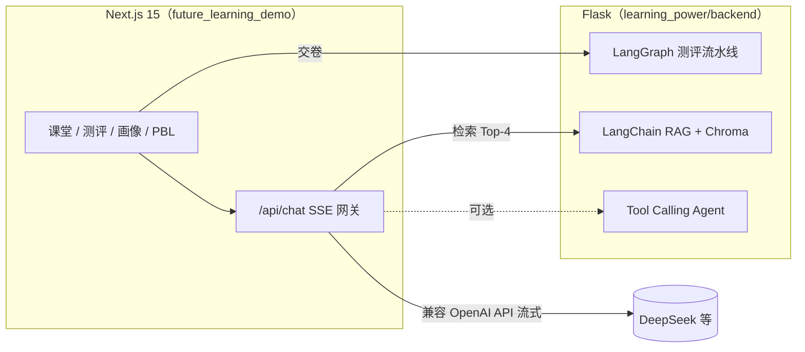

# 吉大未来学习 · AI 智能教育 Agent 平台

**JLU Future Learning · Education Agent Platform**

面向《人工智能基础》课程的一体化教学助手：把 **学习力测评、报告生成、画像答疑、课件伴学、PBL 项目辅导** 接到同一条产品链路里，支持 **本地部署** 与 **可复现压测**。

---

## 一句话介绍

学生可以在网页里 **答题 → 自动出报告与画像**、**边上课边问课件（先检索再答，减少编造）**、**按阶段与不同角色 Agent 做 PBL**；后端用 **LangGraph 固定测评流水线**，前端用 **Next.js SSE 流式网关** 统一承载多场景对话。

---

## 核心亮点

| 维度 | 说明 | 数据 / 出处 |
|------|------|-------------|
| **流式对话稳定性** | Next 网关 SSE 压测，含中止（Abort）场景 | **20 轮成功率 100%** · [`benchmark-results.json`](future_learning_demo/docs/benchmark-results.json) |
| **课件 RAG 召回** | LangChain + Chroma，Top-4 注入课堂 Prompt | **Top-4 命中率 77.8%**（9 题评测集）· [`rag-eval-results.json`](future_learning_demo/docs/rag-eval-results.json) |
| **测评后处理** | 交卷后固定三步，非自由 Agent，保证结构化可回放 | LangGraph **三节点**：评分 → 报告 → 画像数据 |
| **工程化** | Key 仅存服务端；检索 / 流式指标可脚本回归 | `npm run benchmark:chat` · `npm run benchmark:rag` |

*首 token 延迟随本机模型与网络变化，以本地 `benchmark-results.json` 为准。*

---

## 业务闭环

```text
学习力测评（答题）
    → 交卷触发 LangGraph：打分 / 报告 / 画像数据
    → 画像页：基于画像上下文的答疑 Agent

课堂页：学生提问
    → 先检索课件 Top-4 → 再流式生成回答（主路径）
    → 可选 Tool Calling：模型自决策是否调用检索工具

PBL 项目页：按轮次切换教练 / 方案设计 / 评估 等角色 Prompt + 流式对话
```

---

## 技术架构



| 模块 | 技术选型 | 角色 |
|------|----------|------|
| 测评编排 | **LangGraph** StateGraph | 稳定、可回放的结构化后处理 |
| 课件问答 | **LangChain** Retriever + Chroma | 先检后答，降低幻觉 |
| 流式体验 | **SSE** + Abort | 边生成边展示，关页即断流 |
| 可选 Agent | **Tool Calling**（`search_course_materials`） | 模型决定是否先检索 |

更细的链路说明见 **[`docs/ARCHITECTURE.md`](docs/ARCHITECTURE.md)**。

---

## 仓库结构

| 目录 | 内容 |
|------|------|
| [`future_learning_demo/`](future_learning_demo/) | Next.js 前端 + 统一聊天 / SSE 网关 + 压测脚本 |
| [`learning_power/backend/`](learning_power/backend/) | Flask API、LangGraph、LangChain RAG、Tool Agent |
| [`scene-content-kit/`](scene-content-kit/) | 课件 Slide / Quiz 展示组件 |
| [`docs/`](docs/) | 架构、RAG、PBL、压测等说明 |

---

## 主要实现

- **LangChain RAG：** 课件 / QA / 讲义切块入 Chroma；课堂主路径 **Top-4 动态注入**；`@tool` 封装 + **Tool Calling Agent** 可选路径；检索评测脚本与结果落盘。  
- **LangGraph：** 测评交卷后 **三节点** 流水线，JSON 结构化输出，一次返回画像所需数据。  
- **SSE 网关：** 密钥仅服务端；历史裁剪；流式压测与 **首 token / 成功率** 记录。  
- **多 Agent 场景：** PBL 分阶段 Prompt；测评官 / 画像 / 课堂分路由落地。  

补充说明见 [`docs/RESUME_AGENT_PROJECT.md`](docs/RESUME_AGENT_PROJECT.md)。

---

## 快速体验

### 1. 课堂 Agent + RAG

```bash
cd future_learning_demo
cp .env.example .env.local   # 配置 OPENAI_API_KEY（DeepSeek 等兼容端点）
npm install
npm run rag:index            # 构建 Chroma 索引（需 Python 与 embedding 依赖）
npm run dev -- -p 3001
```

浏览器打开提示的本地地址 → **课堂页** 提问，观察流式回答与 RAG 注入。

### 2. 测评后端（LangGraph）

```bash
cd learning_power/backend
cp .env.example .env
pip install -r requirements.txt
python run.py
# Windows 可选：.\scripts\start_flask.ps1
```

### 3. 压测

```bash
cd future_learning_demo
npm run benchmark:chat   # 需 dev 已启动 + Flask 5000
npm run benchmark:rag
```

---

## 文档索引

| 文档 | 用途 |
|------|------|
| [ARCHITECTURE.md](docs/ARCHITECTURE.md) | 三条链路、代码入口 |
| [RAG.md](docs/RAG.md) | 索引构建、LCEL、评测 |
| [LANGGRAPH_ASSESSMENT_PIPELINE.md](docs/LANGGRAPH_ASSESSMENT_PIPELINE.md) | 测评工作流 |
| [PBL_AGENTS.md](docs/PBL_AGENTS.md) | PBL 多角色 |
| [AGENT_BENCHMARK.md](docs/AGENT_BENCHMARK.md) | 压测说明 |

---

## 安全与说明

- **请勿提交** `.env` / `.env.local`；仓库仅含 `.env.example`。  
- 默认配置面向 **课程演示与本地学习**，未按生产级多租户、鉴权强化。  
- Embedding 首次下载可能较慢，可使用镜像（见 [`docs/RAG.md`](docs/RAG.md)）。

---

## License

Learning and portfolio use. 欢迎 Star / Issue；商用请联系作者。