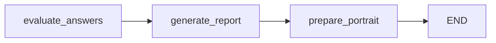

# LangGraph 测评编排（learning_power）

## 流程

- **evaluate_answers**：`LLMClient.batch_evaluate_answers`
- **generate_report**：组装 `final_scores` / `answer_details` / `feedback`
- **prepare_portrait**：输出 `portrait_data`，供 `/api/v1/chat/portrait` 画像对话

## 代码位置

- `learning_power/backend/app/agents/assessment_workflow.py`
- 接入：`POST /api/v1/assessments/sessions/<id>/complete`

## 响应字段

完成测评后额外返回：

- `portrait_data`：画像 Agent 上下文
- `workflow_ms`：编排耗时
- `agent_pipeline`：节点名列表
